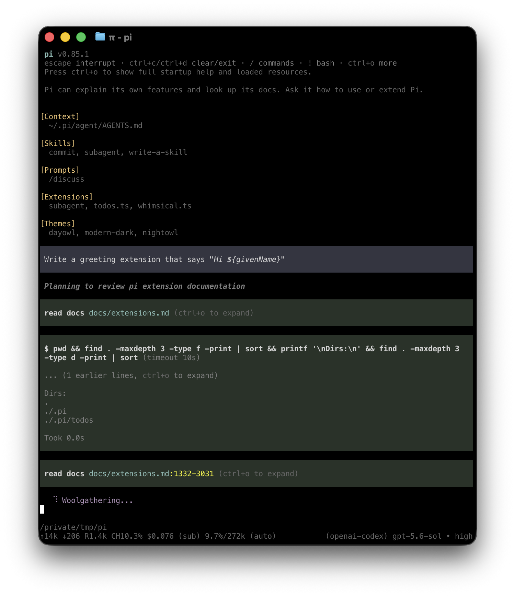

# Quickstart

Ton runs in your terminal and works with files on your machine. To use it, you need access to a model through a supported provider. This can be a subscription, an API key, or a local model.

For native Windows setup, read [Windows Setup](windows.md). For Android, read [Termux Setup](termux.md).

## 1. Install ton

On macOS or Linux, run the installer:

```bash
curl -fsSL https://raw.githubusercontent.com/toninfo/ton/main/install.sh | bash
```

On Windows, run the installer from PowerShell:

```powershell
irm https://raw.githubusercontent.com/toninfo/ton/main/install.ps1 | iex
```

The installer installs a prebuilt release, puts `ton` on your `PATH`, and updates it with `ton update`. To build from source instead, follow the [repository README](https://github.com/toninfo/ton).

Verify the installation:

```bash
ton --version
```

## 2. Start ton

Change to the folder you want ton to work with, then start it:

```bash
cd /path/to/folder
ton
```

The working folder helps ton discover relevant files, instructions, and configuration. Ton also uses it to group saved sessions.

<p align="center"></p>

The interface shows your conversation, an editor for prompts and commands, and a footer with the current folder, model, and session status. See [Use ton in the terminal](usage.md) to learn how to add files, run commands, direct ongoing work, and manage results.

## 3. Choose a model

A **model** generates ton's responses. A **provider** is the service or account ton uses to access that model.

In ton, run:

```text
/login
```

Choose a provider, then follow the prompts to use a subscription or store an API key. Run `/model` afterward if you want to select a different available model.

See [Choose a model and provider](models.md) for supported providers, environment-variable authentication, local models, and custom endpoints.

## 4. Give ton a task

Ton shows each file read, search, command, and edit it performs. It does not ask before every tool call.

Enter a task that matches your work, for example:

```text
Summarize @meeting-notes.md and save the action items to action-items.md.
```

```text
Explain how this repository is structured and how to run its checks.
```

```text
Compare @previous.csv with @current.csv and summarize the important changes.
```

Type `@` in the editor to search for a file instead of entering its full path. When ton finishes, review its response and any changed files. Use version control or backups for important work. For untrusted or unattended work, use a container or another sandbox. See [Security](security.md).

## Continue later

Ton saves sessions automatically. Exit ton, then resume the most recent session for the same working folder with:

```bash
ton --continue
```

Use `/resume` to choose another saved session. See [Continue or branch a session](sessions.md) for session naming, branching, compaction, export, and sharing.

## Next steps

- [Use ton interactively](usage.md) to learn input, commands, shortcuts, and queued messages.
- [Add instructions](configuration.md#context-files) that ton should follow whenever it works in a folder.
- [Choose a model and provider](models.md).

### Choose how to customize ton

Start with the least powerful mechanism that meets your need:

| Need | Start with |
|---|---|
| Give ton persistent instructions for a folder | [`AGENTS.md`](configuration.md#context-files) |
| Reuse a prompt from the `/` menu | [Prompt template](prompt-templates.md) |
| Add task-specific instructions and supporting files | [Skill](skills.md) |
| Add executable tools, commands, or event handlers | [Extension](extensions.md) |
| Build a custom terminal component | [Terminal UI](tui.md) |
| Connect an unsupported model service | [Custom provider](custom-provider.md) |
| Install or distribute several resources | [ton package](packages.md) |

## Uninstall ton

Remove the install directory and the `ton` command the installer added to `PATH`.

On macOS or Linux, the defaults are `~/.local/share/ton` and `~/.local/bin`:

```bash
rm -rf ~/.local/share/ton
rm -f ~/.local/bin/ton ~/.local/bin/pi
```

On Windows, the installer uses `%LOCALAPPDATA%\ton`:

```powershell
Remove-Item -Recurse -Force "$env:LOCALAPPDATA\ton"
```

Remove any custom install or bin directory you chose with `TON_INSTALL_DIR` or `TON_BIN_DIR`. Uninstalling does not remove configuration, credentials, sessions, or installed ton packages from `~/.ton/agent/`.
